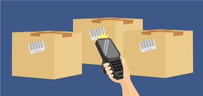
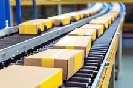
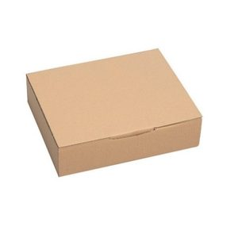
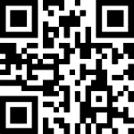

# TD 1 : Caméra linéaire pour la détection de QR Codes sur des boîtes

## Contexte

Une dirigeante d'entreprise fait appel à vos talents en vision industrielle pour moderniser son site de production. Elle vous invite à visiter sa chaîne de production et vous présente un poste de travail où des boîtes en carton, équipées de QR codes, sont scannées à la main par un opérateur.

L'entreprise souhaite moderniser ce poste de travail répétitif et exigeant pour son personnel, tout en augmentant le rythme de production. Lors de votre visite, elle vous explique que les colis arrivent à ce poste via un tapis roulant, avec l'intention d'intégrer un système de vision permettant la lecture automatique des QR codes sur les colis.

L'ingénieur de production vous emmène devant les tapis roulants, vous montre l'installation et vous demande : « Alors, c'est possible ? ».

Après un bref moment d'observation des colis défilant sur le tapis roulant, vous hochez la tête d'un air assuré. Vous lui répondez : « Bien sûr, une caméra linéaire peut faire l'affaire, mais il me faut quelques informations supplémentaires pour la mise en place d'un tel système. »

### Question A

Faire un rapide schéma du système industriel imaginé (avec caméra linéaire) suite à votre bref moment d'observation des colis défilants.

### Question B

Quelles informations complémentaires devez-vous demander pour proposer une configuration fonctionnelle par la suite ?

---

## Informations données par l'ingénieur de production

Suite à vos demandes, voici les informations obtenues pour dimensionner une caméra linéaire répondant au besoin :

| Élément | Illustration |
|---|---|
| Boîte en carton (40 × 30 cm) |  |
| QR Code V2 (2 × 2 cm, grille 25 × 25) |  |

1. **Informations sur les boîtes à scanner :**
   - boîte de dimensions : 40 × 30 cm²
   - les boîtes avancent sur le tapis roulant suivant la longueur de 40 cm
   - la distance entre deux boîtes sur le tapis est de 5 cm

2. **Informations sur le QR Code :**
   - le QR Code V2 a une dimension de 2 × 2 cm²
   - la grille d'encodage du QR Code est de 25 × 25 éléments

3. **Informations de production :**
   - la cadence de production est de 35 boîtes par minute
   - la caméra linéaire scanne ligne par ligne la boîte dans sa largeur de 30 cm
   - la boîte se déplace dans le sens de sa longueur (40 cm) sous la caméra

---

## Questions

**Question 1** : Calculer la taille du plus petit élément à observer.

**Question 2** : Calculer la vitesse nécessaire (en cm/s puis km/h) de défilement des boîtes pour respecter la cadence.

**Question 3** : Quel est le nombre minimal de pixels N que doit contenir le capteur linéaire quand le coefficient C de sécurité est fixé à 2 (pour respecter le théorème de Shannon) ?

**Question 4** : Combien de lignes (ou images) sont nécessaires pour scanner une boîte ?

**Question 5** : Combien de temps faut-il pour scanner une boîte complète ?

**Question 6** : Quelle est la fréquence F d'acquisition des images lignes (le FPS – *Frames per second*) ?

**Question 7** : Sachant que le transfert de l'image d'une ligne vers le système de calcul prend 0,0005 s, quel est le temps maximal d'intégration possible pour la caméra ?

**Question 8** : Une fois la boîte entièrement scannée, le traitement d'image pour détecter et lire le QR Code prend 0,20 s. Vérifiez si ce temps de calcul est suffisant pour suivre la cadence de production.

**Question 9** : Proposer des solutions. Réviser les calculs précédents si besoin en fonction des solutions proposées.

**Question 10** : Quelle est la dynamique d'un QR Code ?

**Question 11** : Quelle est la dynamique de la scène à observer ? (Tapis roulant de couleur noire, colis en carton quasi monochrome, QR Code.)

**Question 12** : Identifier un capteur de votre choix répondant aux spécifications calculées plus haut.

> Quelques noms de distributeurs : Basler, Thorlabs, IDS Imaging, Keyence, etc.

---

## Fichiers associés

- Énoncé complet : [TD1-Boite_QRCODE.pdf](TD1-Boite_QRCODE.pdf)
- Notebook Jupyter : [TD1-Boite_QRCode.ipynb](TD1-Boite_QRCode.ipynb)
- Script Python : [TD1-Boite_QRCode.py](TD1-Boite_QRCode.py)
