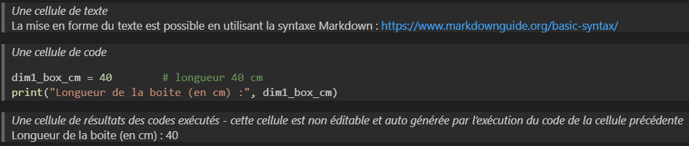
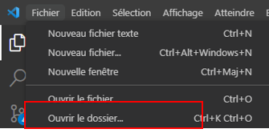
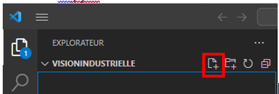
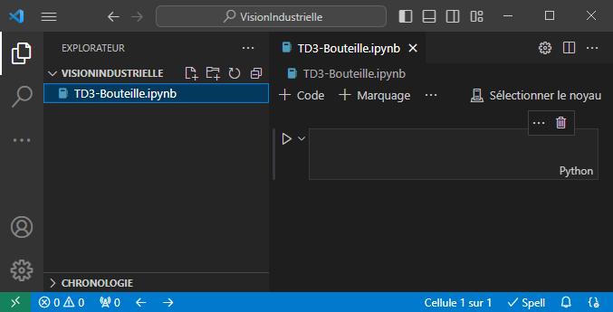

# TD 3 : Application au contrôle qualité d'une gourde décorée

## Prérequis : créer un notebook Jupyter avec VS Code

Les notebooks Jupyter sont des cahiers électroniques permettant, dans un même document, l'utilisation de cellules de texte, de cellules de code (souvent en Python), et de cellules pour l'affichage des résultats.

### Étapes de création

1. Sur le bureau, créez un dossier de travail « VisionIndustrielle » 
2. Ouvrez Visual Studio Code (VSCode), puis allez dans le menu Fichier → Ouvrir le dossier de travail :

   

3. Dans le panneau EXPLORATEUR, ajoutez un nouveau fichier nommé `TD3-Bouteille.ipynb` :

   

4. Vous devez obtenir quelque chose comme ceci :

   

> Liens utiles :
> - [Jupyter dans VS Code](https://code.visualstudio.com/docs/datascience/jupyter-notebooks)
> - [Syntaxe Markdown](https://www.markdownguide.org/basic-syntax/)

---

## Contexte

Vous devez concevoir un système de vision pour inspecter des **gourdes décorées en rotation** à l'aide d'une **caméra linéaire**.

### Données du problème

| Paramètre | Valeur |
|---|---|
| Cadence de production | 5 gourdes en 3 secondes |
| Hauteur de la gourde | 25 cm |
| Diamètre maximal (φ) | 45 mm |
| Plus petit élément à détecter | 0,15 mm |

---

## Questions

**Question 1** : Quel est le périmètre maximal de la gourde ?

**Question 2** : Quelle est la vitesse de déplacement d'un élément du motif de la gourde ?

**Question 3** : Quel est le nombre de pixels nécessaires pour le capteur linéaire (avec un coefficient de sécurité C = 2) ?

**Question 4** : Quel est le nombre minimal de lignes nécessaires pour le scan complet de la gourde ?

**Question 5** : Calculer la fréquence F minimale d'acquisition pour la caméra (ou nombre d'images par seconde).

**Question 6** : Le temps de transfert d'une ligne est de 15 × 10⁻⁵ s. Quel est le temps d'exposition maximal possible ?

**Question 7** : Trouver une caméra répondant au besoin.
> Quelques noms de distributeurs : Basler, Thorlabs, IDS Imaging, Keyence, etc.

**Question 8** : Calculer le grandissement pour le capteur sélectionné.
> On pourra prendre par exemple une caméra 4k (4096 pixels) avec des pixels de 7 µm.

**Question 9** : Calculer la distance de travail de la caméra pour les focales 6 mm, 8 mm et 12 mm.
> La distance maximale disponible est de 10 cm. Choisir la meilleure focale.

**Question 10** : Lors d'un premier test avec un temps d'exposition Ti = 3 × 10⁻⁴ s, la valeur maximale de l'image est de 45. En supposant que la réponse de la caméra est linéaire, de combien devez-vous augmenter le temps d'exposition pour exploiter la dynamique complète du capteur 8 bits (255 niveaux) ?

**Question 11** : Est-il possible d'exploiter complètement la dynamique du capteur tout en respectant les cadences de production ? Si non, proposer une solution.

---

## Fichiers associés

- Énoncé complet : [TD3-JupyterNotebookBouteille.docx](TD3-JupyterNotebookBouteille.docx)
- Notebook Jupyter : [TD3-JupyterNotebookBouteille.ipynb](TD3-JupyterNotebookBouteille.ipynb)
- Script Python : [TD3-JupyterNotebookBouteille.py](TD3-JupyterNotebookBouteille.py)
